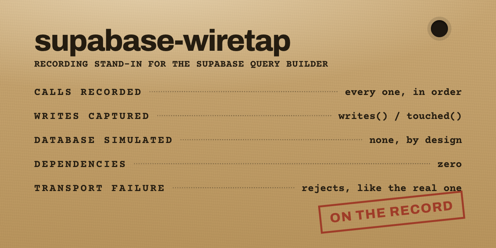

# supabase-wiretap

[](https://github.com/damson/supabase-wiretap/actions/workflows/ci.yml)
[](#how-it-is-tested)
[](LICENSE)
[](#requirements)
[](#typescript)
[](package.json)

**Test the code that talks to your Supabase database, without a database.**

You decide what the database answers. Your code runs against a recorder.
Then you check what your code asked for: which table, which filters, which rows
it tried to write.

No container, no fixtures, no cleanup. Tests run in milliseconds.

```ts
import { fakeSupabase } from 'supabase-wiretap';

// 1. Decide what the database answers.
const fake = fakeSupabase(() => ({ data: [{ id: 'e1' }], error: null }));

// 2. Run your code against the recorder.
await approveEntry('e1', fake.asClient<SupabaseClient>());

// 3. Check what your code tried to do.
expect(fake.writes('entries', 'insert')).toEqual([{ lemma: 'kaz', approved: true }]);
expect(fake.touched('audit_log')).toBe(true);
```

## Contents

- [Requirements](#requirements)
- [Install](#install)
- [Your first test](#your-first-test)
- [The idea behind it](#the-idea-behind-it)
- [Recipes](#recipes)
- [API reference](#api-reference)
- [TypeScript](#typescript)
- [Limits](#limits)
- [FAQ](#faq)
- [Contributing](#contributing)

## Requirements

- **Node 20 or newer.**
- **ESM only.** There is no CommonJS build.
- **Any test runner** that can `import` an ES module. Vitest and `node:test`
  work as is. Jest needs its ESM support turned on.
- **No Supabase install needed.** `@supabase/supabase-js` is not a dependency,
  not even a peer one.

## Install

```sh
npm install --save-dev supabase-wiretap
```

## Your first test

Here is a function that loads an item, writes a row, and updates another row:

```ts
// src/approve.ts
export async function approveEntry(id: string, client: SupabaseClient) {
  const { data, error } = await client.from('review_items').select('*').eq('id', id).single();
  if (error) throw new Error('could not load the item');

  await client.from('entries').insert({ lemma: data.lemma, approved: true });
  await client.from('review_items').update({ status: 'approved' }).eq('id', id);
}
```

And a test for it, with one success case and one failure case:

```ts
import { describe, expect, it } from 'vitest';
import { fakeSupabase } from 'supabase-wiretap';
import { approveEntry } from './approve';

describe('approveEntry', () => {
  it('writes the entry and marks the review item approved', async () => {
    // Every query gets this answer.
    const fake = fakeSupabase(() => ({ data: { lemma: 'kaz' }, error: null }));

    await approveEntry('r1', fake.asClient<SupabaseClient>());

    expect(fake.writes('entries', 'insert')).toEqual([{ lemma: 'kaz', approved: true }]);
    expect(fake.writes('review_items', 'update')).toEqual([{ status: 'approved' }]);
  });

  it('writes nothing when the item cannot be loaded', async () => {
    const fake = fakeSupabase(() => ({ data: null, error: { message: 'not found' } }));

    await expect(approveEntry('r1', fake.asClient<SupabaseClient>())).rejects.toThrow();
    expect(fake.touched('entries')).toBe(false);
  });
});
```

Three things to know:

1. The function you pass to `fakeSupabase` is the **responder**. It is called
   once per query and returns what the database would reply.
2. `fake.asClient<T>()` gives you the recorder typed as your real client. See
   [TypeScript](#typescript).
3. `writes()` and `touched()` tell you what your code did.

## The idea behind it

This package records calls. It never acts like a database.

A fake that stores rows and answers queries from them has to guess how Postgres
filters, sorts and joins. When it guesses wrong, your test still passes, because
your code and your fake agree with each other. You end up maintaining a second,
less correct database.

So this one stores nothing. You test the decisions your code makes: the row it
writes, the filter it uses, the write it skips when validation fails.

It cannot tell you whether a column exists or a constraint would reject a row.
Keep a smaller suite that runs against a real database for those questions.

## Recipes

### Answer different tables differently

Return `undefined` for "no opinion". That answers `{ data: null, error: null }`.

```ts
import { fakeSupabase, type Responder } from 'supabase-wiretap';

const responder: Responder = (call) => {
  if (call.table === 'review_items') return { data: [{ id: 'r1' }], error: null };
  if (call.table === 'profiles') return { data: null, error: { message: 'denied' } };
  return undefined;
};

const fake = fakeSupabase(responder);
```

### Answer based on the filters

```ts
const responder: Responder = (call) =>
  call.ops.some(([op, col, value]) => op === 'eq' && col === 'status' && value === 'pending')
    ? { data: [{ id: 'r1' }], error: null }
    : { data: [], error: null };
```

### Give answers in sequence

```ts
const answers = [{ data: [{ id: 'r1' }], error: null }, { data: [], error: null }];
const fake = fakeSupabase(() => answers.shift());
```

### Check the query itself

`fake.calls` lists every awaited query, in order. Each one has its `table` and
its chain of `ops`, in the order they were built. A query is recorded when it is
awaited.

```ts
await nextPendingId(fake.asClient<SupabaseClient>(), { sort: 'score', excludeId: 'r1' });

expect(fake.calls[0].table).toBe('review_queue');
expect(fake.calls[0].ops).toContainEqual(['neq', 'id', 'r1']);
```

### Test errors and dropped connections

Supabase has two failure paths, and your code handles them differently:

```ts
// A query error: the promise resolves with `error` filled in.
const denied = fakeSupabase(() => ({ data: null, error: { message: 'permission denied' } }));

// A dropped connection: the promise rejects.
const offline = fakeSupabase(() => {
  throw new Error('fetch failed');
});
```

The call is recorded in both cases.

### Count rows

For `select('id', { count: 'exact', head: true })`, put the number in `count`:

```ts
const fake = fakeSupabase((call) =>
  call.table === 'review_queue' ? { data: null, error: null, count: 544 } : undefined,
);
```

### Stored procedures (`rpc`)

An `rpc` call is recorded under the table name `rpc:<function>`. Its arguments
follow `'rpc'` in its single operation.

```ts
const fake = fakeSupabase((call) =>
  call.table === 'rpc:current_app_role' ? { data: 'reviewer', error: null } : undefined,
);

await expect(requireAdmin(fake.asClient<SupabaseClient>())).rejects.toThrow('insufficient role');
expect(fake.calls[0].ops).toEqual([['rpc']]);
```

### Prove nothing was written

A rejected submission leaves no row to look for. `touched()` checks that the
table was never reached:

```ts
await expect(submit({ lemma: 'kaz', origins: [] }, fake.asClient<SupabaseClient>())).rejects.toThrow();

expect(fake.touched('entries')).toBe(false);
```

### Storage uploads

Uploads are recorded. Pass a storage error to make every upload fail:

```ts
const ok = fakeSupabase();
await handleUpload(file, ok.asClient<SupabaseClient>());
expect(ok.uploads).toEqual([{ bucket: 'imports', path: 'batch/1.csv', contentType: 'text/csv' }]);

const broken = fakeSupabase({ storageError: { message: 'bucket not found' } });
await handleUpload(file, broken.asClient<SupabaseClient>());
expect(broken.uploads).toEqual([]);
```

### Listing accounts (`auth.admin.listUsers`)

The lister returns one page per call:

```ts
const fullThenShort: AccountLister = (page, perPage) =>
  page === 1
    ? { users: Array.from({ length: perPage }, (_, i) => ({ id: `u${i}` })) }
    : { users: [{ id: 'last' }] };

const fake = fakeSupabase({ lister: fullThenShort });
await collectAccounts(fake.asClient<SupabaseClient>());
expect(fake.listedPages).toEqual([1, 2]);
```

## API reference

### `fakeSupabase(options?)`

All options are optional. `fakeSupabase()` answers every query with
`{ data: null, error: null }`.

| Option | Type | What it does |
|---|---|---|
| `responder` | `(call) => Answer \| undefined` | Answers every query and `rpc`. Throw to simulate a dropped connection. |
| `storageError` | `{ message } \| null` | Every upload fails with this error, and none is recorded. |
| `lister` | `(page, perPage) => AccountPage` | Backs `auth.admin.listUsers`, one page per call. |

The positional form `fakeSupabase(responder, storageError, lister)` also works.

### What it returns

| Field | Type | What it holds |
|---|---|---|
| `client` | object | The recorder. Pass it where the real client goes. |
| `asClient<T>()` | `() => T` | The same object, typed as `T`. |
| `calls` | `Call[]` | Every awaited query, in order. |
| `writes(table, op)` | `unknown[]` | The payload of each `insert`, `upsert`, `update` or `delete` on `table`. |
| `touched(table)` | `boolean` | Whether `table` was queried at all. |
| `uploads` | `Upload[]` | Every accepted storage upload. |
| `listedPages` | `number[]` | The `listUsers` pages requested, in order. |

### Types

```ts
interface Call {
  table: string;                    // the table, or `rpc:<function>`
  ops: [string, ...unknown[]][];    // the chain, in the order it was built
}

interface Answer {
  data: unknown;
  error: unknown;
  count?: number | null;            // for count queries
}
```

### Recorded builder methods

`select` `insert` `upsert` `update` `delete` `eq` `neq` `gt` `gte` `lt` `lte`
`like` `ilike` `is` `in` `contains` `containedBy` `overlaps` `match` `not` `or`
`filter` `order` `limit` `range` `single` `maybeSingle` `returns`

The list is exported as `CHAIN_METHODS`. Calling a method that is not on it
throws, so a missing method cannot make a test pass by accident. Need one?
Adding it is a one-line change: see [CONTRIBUTING.md](CONTRIBUTING.md).

## TypeScript

Types ship with the package.

`client` is typed as the part of the client this package implements, not as
`SupabaseClient`. Use `asClient<T>()` where you pass it to your code:

```ts
import type { SupabaseClient } from '@supabase/supabase-js';

await myServerAction(fake.asClient<SupabaseClient>());
```

This is a type cast. Keeping it in one place per test makes that easy to see.

## Limits

These are deliberate:

- **Filters are recorded, never applied.** `eq` narrows nothing.
- **Nothing is stored.** You cannot select back what you inserted.
- **Not covered:** realtime, edge functions, `storage.download` and
  `storage.remove`. They are missing rather than stubbed, so using one fails
  loudly instead of passing silently.
- **Only two assertion helpers**, `writes` and `touched`. `calls` is a plain
  array, so your test runner's matchers work on it.

## FAQ

**Can I check that a query was not made?**
Yes: `touched(table)`. For finer checks, use `some`, `filter` or `find` on
`calls`.

**How do I simulate a timeout?**
Throw in the responder: your code sees a rejected promise. For a real delay,
use your test runner's fake timers.

**My code calls a method that is not recorded, and the test throws.**
That is intended. Open an issue, or add the method to `CHAIN_METHODS` and send a
pull request.

**Is this an official Supabase project?**
No. It is independent, and not affiliated with or endorsed by Supabase.

## How it is tested

- **Unit tests** cover 100% of statements, branches, functions and lines. The
  Vitest config enforces the threshold.
- **A compatibility suite** (`src/compat.test.ts`) types its code against the
  real `SupabaseClient`, then runs it against the recorder. It fails if a
  builder method that real code needs is missing.
- **CI installs the packed tarball** on Node 20 in an empty project and runs it,
  the way a user would.

## Contributing

Small contributions are welcome: a missing builder method, a confusing
sentence, a use case that does not fit. [CONTRIBUTING.md](CONTRIBUTING.md)
explains the setup. Please follow the [Code of Conduct](CODE_OF_CONDUCT.md).

## Licence

[MIT](LICENSE). Copyright 2026 Damien D.
